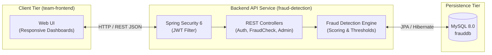

# 🛡️ FraudGuard AI — AI-Powered Fraud Detection System

[](https://openjdk.org/)
[](https://spring.io/projects/spring-boot)
[](https://www.mysql.com/)
[](https://developer.mozilla.org/)
[](LICENSE)

An intelligent, real-time financial transaction risk assessment and fraud detection platform. **FraudGuard AI** intercepts payment streams, calculates probabilistic risk scores, identifies anomalies, and surfaces actionable intelligence through an interactive dashboard for users and compliance administrators.

---

## 🌟 Key Features

* **⚡ Real-Time Anomaly Scoring**: Sub-second heuristic and rule-based evaluation assessing velocity, location deviations, channel risks, and threshold spikes.
* **🛡️ Multi-Level Risk Classification**: Categorizes transactions into `SAFE` (0–39), `SUSPICIOUS` (40–69), and `HIGH RISK / BLOCKED` (70–100).
* **🔐 Enterprise Security & RBAC**: Stateless JWT authentication, BCrypt salted password encryption, and distinct role authorization (`ROLE_USER` vs. `ROLE_ADMIN`).
* **📊 Dual Role Portals**:
  * **User Dashboard**: Instant transaction submission, risk meter visualization, real-time status explanations, and payment history.
  * **Admin Investigation Console**: Global KPIs, live audit logs, transaction queue filtering, user permission control, and suspicious case resolution.
* **🔄 Resilient Dual-Mode Operation**: Seamlessly connects to the Spring Boot REST API and MySQL database, with automatic fallback simulation caching in `localStorage` when offline.

---

## 🏗️ Architecture Overview



> 📖 For an in-depth breakdown of components and sequence diagrams, refer to [**System Architecture Documentation**](docs/ARCHITECTURE.md).

---

## 📁 Repository Structure

```
AI-POWERED FRAUD DETECTION SYSTEM/
│
├── fraud-detection/                 # Spring Boot Backend API Service
│   ├── src/main/java/com/frauddetection/
│   │   ├── controller/             # REST Controllers (Auth, FraudCheck, Admin)
│   │   ├── dto/                    # Data Transfer Objects
│   │   ├── model/                  # JPA Entities (User, Transaction, FraudCase)
│   │   ├── repository/             # Spring Data Repositories
│   │   ├── security/               # JWT Utilities, Filter & Security Configuration
│   │   └── service/                # Business Logic & Fraud Scoring Service
│   ├── src/main/resources/
│   │   ├── application.properties  # MySQL & Security configuration
│   │   └── static/                 # Embedded Web Assets served by Tomcat
│   ├── mvnw & mvnw.cmd             # Maven Wrapper scripts
│   ├── pom.xml                     # Maven project descriptor
│   └── README.md                   # Backend specific documentation
│
├── team-frontend/                   # Standalone Web Application
│   ├── index.html                  # Landing page & feature showcase
│   ├── login.html                  # User & Admin authentication portal
│   ├── register.html               # New account registration
│   ├── user-dashboard.html         # User summary & metrics
│   ├── transaction.html            # AI Fraud Scanner & transaction form
│   ├── history.html                # Transaction log & history table
│   ├── alerts.html                 # User alert notification center
│   ├── profile.html                # User profile management
│   ├── admin.html                  # Admin executive overview
│   ├── admin-transactions.html     # Admin live transaction monitor
│   ├── admin-alerts.html           # Admin suspicious case alerts
│   ├── admin-users.html            # Admin user directory & role management
│   ├── admin-reports.html          # Admin risk analytics & reports
│   ├── admin-profile.html          # Admin profile configuration
│   ├── script.js                   # Application logic, REST client & fallback
│   ├── style.css                   # Modern CSS styling with dark accents
│   └── README.md                   # Frontend specific documentation
│
├── docs/                           # Project Documentation
│   ├── ARCHITECTURE.md             # System design & sequence workflows
│   ├── API_DOCUMENTATION.md        # REST API endpoints & payload schemas
│   ├── DATABASE_SCHEMA.md          # MySQL relational schema & data dictionary
│   └── DEPLOYMENT_GUIDE.md         # Local & Cloud hosting guide
│
├── run-website.bat                 # One-click Windows launcher
├── .gitignore                      # Git ignore rules for builds & IDEs
├── LICENSE                         # MIT License
└── README.md                       # Main project documentation
```

---

## 🚀 Quick Start Guide

### Prerequisites
* **Java**: JDK 21 or higher installed (Tested with OpenJDK 25 / 26)
* **MySQL**: MySQL Server 8.0 running locally on port `3306`
* **Git**: Installed on your system

### 1. Database Configuration
Ensure MySQL is running with a user named `root` (password: `admin`). The database `frauddb` and its tables will be created automatically on startup:
```sql
CREATE DATABASE IF NOT EXISTS frauddb;
```
*(You can customize database credentials inside [`fraud-detection/src/main/resources/application.properties`](fraud-detection/src/main/resources/application.properties)).*

### 2. Launch the Application

#### Option A: One-Click Windows Launch
Double-click `run-website.bat` in the root folder.

#### Option B: Terminal Command Launch
```powershell
# Navigate to backend directory
cd fraud-detection

# Run with Maven Wrapper
./mvnw spring-boot:run          # Linux / macOS
mvnw.cmd spring-boot:run        # Windows
```

### 3. Open in Browser
Visit **[http://localhost:8080/](http://localhost:8080/)** in any modern web browser.

---

## 🔑 Default Credentials

The system initializes default accounts upon first startup:

| Role | Email | Password | Access Level |
| :--- | :--- | :--- | :--- |
| **System Admin** | `admin@frauddetection.com` | `admin123` | Full access to Admin Console, Case Review & Role Management |
| **Standard User** | Register via `register.html` | Any (min 6 chars) | User Dashboard, Transaction Scanning & Personal History |

---

## 📚 Documentation Directory

* [**Architecture & System Design**](docs/ARCHITECTURE.md)
* [**REST API Documentation**](docs/API_DOCUMENTATION.md)
* [**Database Schema & Dictionary**](docs/DATABASE_SCHEMA.md)
* [**Deployment & Hosting Guide**](docs/DEPLOYMENT_GUIDE.md)

---

## 📄 License

This project is licensed under the MIT License — see the [LICENSE](LICENSE) file for details.
