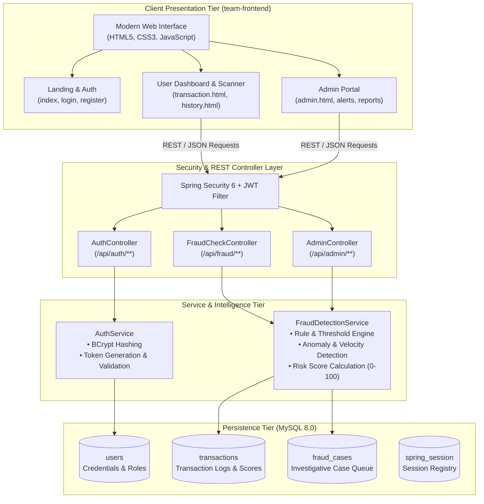
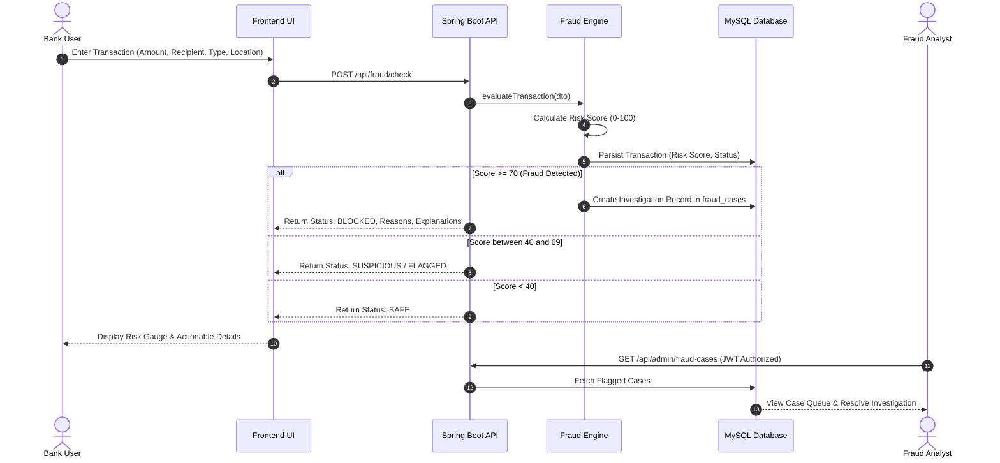

# 🏗️ System Architecture & Design Breakdown

The **AI-Powered Fraud Detection System** (FraudGuard AI) is an enterprise financial security solution engineered to intercept, evaluate, and mitigate suspicious financial transactions in real time.

---

## 1. High-Level Architectural Diagram

---

## 2. Core Architectural Components

### 2.1 Client Presentation Layer (`team-frontend`)
* **Responsive Multi-Dashboard UI**: Tailored layouts for regular bank users and compliance/security admins.
* **Dual Operation Mode**:
  * **Online Connected Mode**: Synchronizes directly with the Spring Boot REST endpoints (`/api/fraud/*`).
  * **Resilient Offline / Fallback Mode**: If the backend is undergoing maintenance or network connectivity is interrupted, the client automatically executes local risk heuristic scoring and caches state in `localStorage`.

### 2.2 Security & Authentication Layer
* **Stateless JWT Architecture**: Employs JSON Web Tokens (`jjwt-api 0.12.6`) with cryptographic signing.
* **Role-Based Access Control (RBAC)**: Segregates normal account holders (`ROLE_USER`) from security investigators (`ROLE_ADMIN`).
* **BCrypt Password Encryption**: Strong salt-hashed password storage preventing credential compromise.

### 2.3 Fraud Detection & Scoring Engine (`FraudDetectionService`)
The detection pipeline computes an aggregate risk score ranging from `0` to `100` evaluated across multiple risk vectors:

| Risk Dimension | Heuristic / Threshold Criteria | Added Risk Points |
| :--- | :--- | :--- |
| **High Value Anomaly** | Amount exceeds `₹50,000` | +25 points |
| **Critical Spike** | Amount exceeds `₹100,000` | +40 points |
| **Channel Risk** | Transaction Type = `Withdrawal` or `Transfer` | +10 to +15 points |
| **Location Anomaly** | Cross-border or mismatched transaction origin | +20 points |
| **Velocity & Frequency** | Multiple transactions in rapid succession | +25 points |

#### Decision Matrix:
* **Score 0 – 39**: `SAFE` &rarr; Approved automatically.
* **Score 40 – 69**: `SUSPICIOUS` &rarr; Flagged for review; stepped-up verification required.
* **Score 70 – 100**: `BLOCKED` &rarr; Immediate payment halt; logged into `fraud_cases` queue for investigative review.

---

## 3. Data Flow & Transaction Lifecycle

---

## 4. Scalability & Future Roadmap
* **Asynchronous Ingestion via Apache Kafka**: Decouple high-velocity transaction streams from storage.
* **ONNX / Python Microservice Integration**: Seamless connection to Python-trained ensemble models (XGBoost, Random Forest, PyTorch LSTM) and SHAP explainability trees.
* **Elasticsearch / OpenSearch**: Real-time log indexing for forensic compliance audits.
