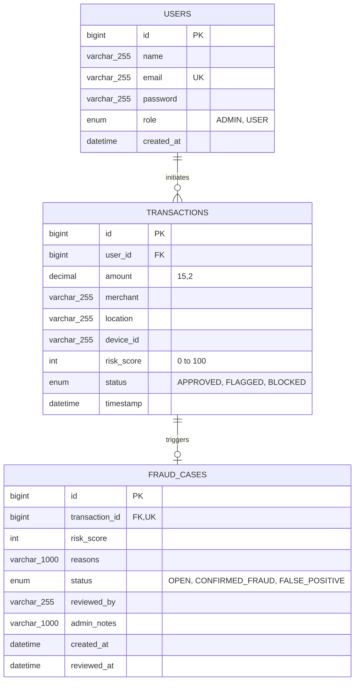

# 🗄️ Database Schema & Data Dictionary

FraudGuard AI utilizes a relational **MySQL 8.0** database named `frauddb` managed automatically via **Spring Data JPA & Hibernate** (`ddl-auto=update`).

---

## 1. Entity-Relationship Diagram



---

## 2. Table Specifications

### 2.1 `users` Table
Stores account credentials, profile details, and role assignments.

| Column | Type | Nullable | Key | Description |
| :--- | :--- | :--- | :--- | :--- |
| `id` | `BIGINT` | NO | Primary Key | Auto-increment unique user identifier |
| `name` | `VARCHAR(255)` | NO | | User's full name |
| `email` | `VARCHAR(255)` | NO | Unique | Login email address |
| `password` | `VARCHAR(255)` | NO | | BCrypt encrypted password hash |
| `role` | `ENUM('ADMIN','USER')` | NO | | Security authority role |
| `created_at` | `DATETIME(6)` | NO | | Registration timestamp |

### 2.2 `transactions` Table
Stores financial transactions evaluated by the fraud engine.

| Column | Type | Nullable | Key | Description |
| :--- | :--- | :--- | :--- | :--- |
| `id` | `BIGINT` | NO | Primary Key | Auto-increment transaction identifier |
| `user_id` | `BIGINT` | NO | Foreign Key | References `users(id)` |
| `amount` | `DECIMAL(15,2)` | NO | | Transaction monetary value in INR |
| `merchant` | `VARCHAR(255)` | NO | | Recipient / merchant name |
| `location` | `VARCHAR(255)` | YES | | Geographical location of payment |
| `device_id` | `VARCHAR(255)` | YES | | Fingerprint of originating client |
| `risk_score` | `INT` | NO | | Computed risk index (`0` – `100`) |
| `status` | `ENUM('APPROVED', 'FLAGGED', 'BLOCKED')` | NO | | Automated determination result |
| `timestamp` | `DATETIME(6)` | NO | | Transaction submission timestamp |

### 2.3 `fraud_cases` Table
Maintains investigative records for suspicious or blocked transactions.

| Column | Type | Nullable | Key | Description |
| :--- | :--- | :--- | :--- | :--- |
| `id` | `BIGINT` | NO | Primary Key | Auto-increment case identifier |
| `transaction_id` | `BIGINT` | NO | Foreign Key (1:1) | References `transactions(id)` |
| `risk_score` | `INT` | NO | | Risk score at time of alert |
| `reasons` | `VARCHAR(1000)` | YES | | Summary of detection rules triggered |
| `status` | `ENUM('OPEN', 'CONFIRMED_FRAUD', 'FALSE_POSITIVE')` | NO | | Current status in review workflow |
| `reviewed_by` | `VARCHAR(255)` | YES | | Email/ID of reviewing admin |
| `admin_notes` | `VARCHAR(1000)` | YES | | Findings recorded during review |
| `created_at` | `DATETIME(6)` | NO | | Alert creation timestamp |
| `reviewed_at` | `DATETIME(6)` | YES | | Investigation resolution timestamp |

---

## 3. Database Initialization & Configuration
Configured in `application.properties`:
```properties
spring.datasource.url=jdbc:mysql://localhost:3306/frauddb?createDatabaseIfNotExist=true&useSSL=false&serverTimezone=UTC&allowPublicKeyRetrieval=true
spring.datasource.username=root
spring.datasource.password=admin
spring.datasource.driver-class-name=com.mysql.cj.jdbc.Driver

spring.jpa.hibernate.ddl-auto=update
spring.jpa.show-sql=true
```
